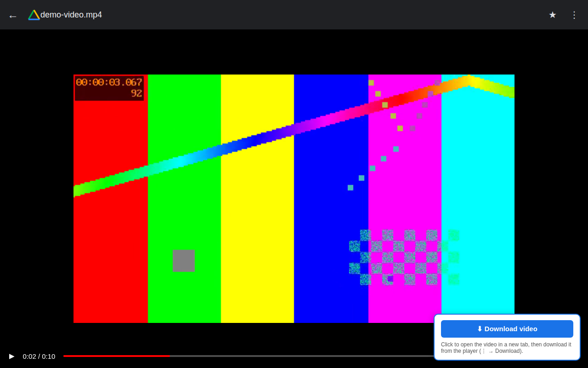
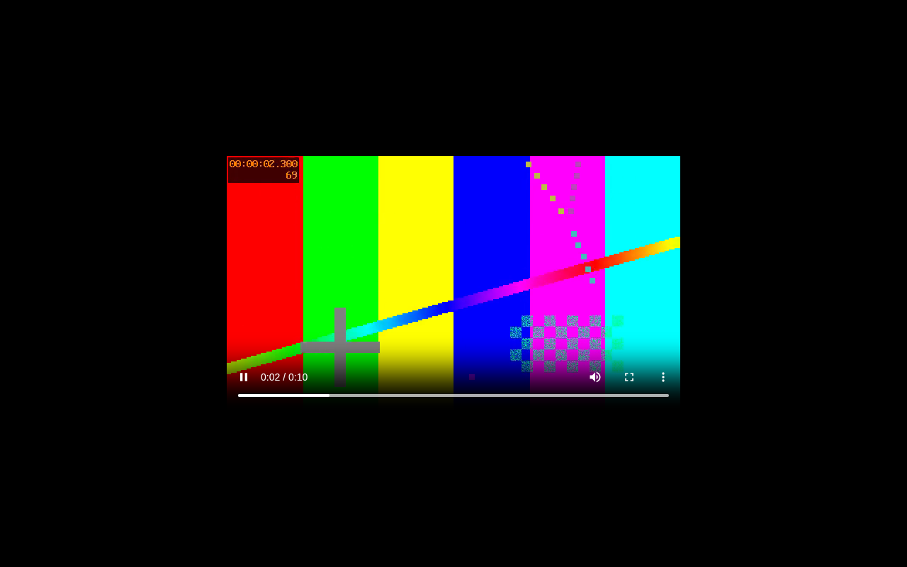

# Drive Video Downloader

A small Chrome extension (Manifest V3) that adds a **download button** to
Google Drive video pages.

Google Drive lets you watch shared videos but the owner can disable
downloading. If you can play a video, this extension surfaces the
progressive stream URL the player itself already receives and puts a button
on the page to open it — from there, the player's own menu (⋮ → Download)
saves the file.

## How it works

Re-fetching the playback URL from a bookmarklet or the console fails with
`403 PERMISSION_DENIED`, even while the video is playing in that same
session. The extension does not re-issue the request: it **observes** the
one the player makes.

- `hook.js` runs in the page's MAIN world (so it sees the player's `fetch`
  and `XMLHttpRequest`, not isolated copies) and is injected as early as
  possible: via the manifest content script (`document_start`) and, as a
  fallback, by `background.js` when the page loads. It has a guard against
  double injection (the Drive viewer is a SPA). It only observes and
  forwards: it never touches the DOM and never opens anything. It also
  wraps `history.pushState`/`replaceState` — in the MAIN world, where the
  page's own router calls them — and notifies the content script when the
  viewer navigates to another video. The file ID of a capture is bound
  when its request starts (from the request URL, or from the address bar
  at that moment), never when the response arrives, so a late response
  for a video you already left cannot be attributed to the new one.
- `content.js` runs in the extension's isolated world and owns the rest: it
  listens for the hook's messages, keeps the captured URL bound to the file
  being viewed, shows the button, and opens the link. When you navigate to
  another video without reloading, the state resets and the button only
  appears again once the new video's link is detected — a previous video's
  URL is never offered. Navigation is detected from the hook's
  notification, with a `popstate` listener and a 1 s poller as fallbacks.
  It validates every message (same window and origin,
  expected shape, well-formed file ID) and the click re-checks the file ID
  against the address bar, so a click racing a navigation cannot open a
  stale URL.
- When a response arrives from the playback API (URL containing
  `/drive/media/` and `playback`), it extracts the progressive link: itag 18
  (360p with audio), else 22 (720p), else the first progressive transcode,
  with a recursive fallback. It then shows a fixed **⬇ Download video**
  button; clicking it (a user gesture) opens the link in a new tab.
- If the response carries no link, the button downloads the response as
  `response.json` instead, so you can inspect it.
- It sends nothing anywhere: everything stays between your browser and
  Google. No account data, no analytics, no third-party requests.

## Install (first time only)

1. Download this repository as a ZIP (Code → Download ZIP) and unzip it, or
   clone it.
2. In Chrome, open `chrome://extensions`.
3. Turn on **Developer mode** (top right).
4. Click **Load unpacked** and pick the unzipped folder.
5. Open any video in Google Drive and wait for it to start loading: the
   **⬇ Download video** button appears at the bottom right.

If the video was already open when you installed the extension, reload the
page (F5): the hook has to be in place before the player requests the data.

Chrome may show a developer-mode warning on startup; dismiss it and the
extension keeps working.

## Limitations

- **Progressive streams only.** It works when Google serves a progressive
  transcode (itag 18 or 22, 360p/720p with audio). Most Drive videos have
  one; some don't, and then there is nothing to download this way.
- **It depends on Drive's internal playback API.** If Google changes how
  the player requests the video, the extension stops working until it is
  updated.
- **Google Drive only.** It does not work on YouTube or any other site.
- **Not affiliated with Google.** This is an independent, unofficial tool.
  Please respect the owner's wishes: the extension makes downloading
  possible where you can already watch the video, it does not grant access
  to anything you cannot play.

## Files

- `manifest.json` — MV3, `scripting` permission and
  `https://drive.google.com/*` host permission.
- `background.js` — service worker: re-injects the hook and the content
  script when the page loads.
- `hook.js` — the capture hook (MAIN world): observes the player's
  requests and forwards the progressive link with its file ID, and
  notifies the content script of SPA navigation.
- `content.js` — the content script (isolated world): per-video state,
  navigation handling (hook notification, `popstate`, 1 s poller
  fallback), message validation, the button, and the single place that
  opens a captured URL.
- `test/` — Node tests with a stubbed browser (separate MAIN and isolated
  worlds, bridged only by `postMessage`) and an anonymized playback
  fixture. Run with `node test/test-extension.js`.

## License

MIT — see [LICENSE](LICENSE).
